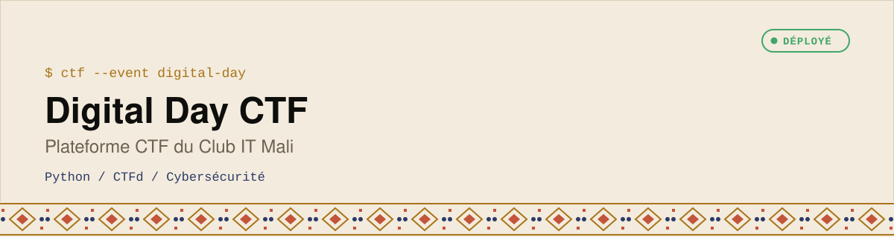

  <picture>
    <source media="(prefers-color-scheme: dark)" srcset="assets/banner-dark.svg">
    
  </picture>

*Custom Capture The Flag platform built for the biggest IT event in Mali.*

  
  
  

## 🚀 Overview
This repository hosts the custom Capture The Flag (CTF) platform deployed for the **Digital Day** event organized by Club IT in Mali. It is designed to handle hundreds of concurrent participants engaging in cybersecurity challenges.

## ✨ Key Features
- 🔒 **Robust Challenge System**: Supports various categories (Web, Crypto, Pwn, Reverse).
- 📊 **Real-time Leaderboard**: Dynamic scoring and visualization of team rankings.
- 👥 **Team Management**: Complete flow for registration, team formation, and collaboration.
- 🛡️ **Secure Infrastructure**: Built to withstand attacks while participants attempt to hack the challenges.

## 🎯 Purpose
Created to promote cybersecurity awareness and foster technical talent in Mali through gamified learning.

## 👨‍💻 Developer
Built by [BinaryMaoGenius](https://github.com/BinaryMaoGenius) — Passionate about Cybersecurity and African Tech Ecosystems.